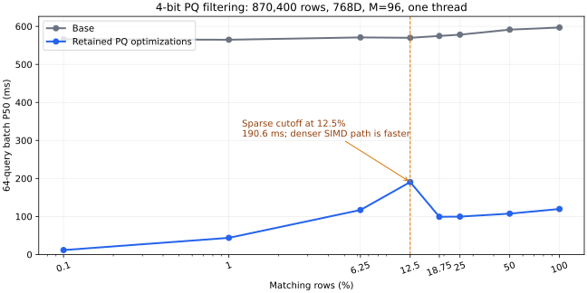

<!--
  ~ Licensed to the Apache Software Foundation (ASF) under one
  ~ or more contributor license agreements.  See the NOTICE file
  ~ distributed with this work for additional information
  ~ regarding copyright ownership.  The ASF licenses this file
  ~ to you under the Apache License, Version 2.0 (the
  ~ "License"); you may not use this file except in compliance
  ~ with the License.  You may obtain a copy of the License at
  ~
  ~   http://www.apache.org/licenses/LICENSE-2.0
  ~
  ~ Unless required by applicable law or agreed to in writing,
  ~ software distributed under the License is distributed on an
  ~ "AS IS" BASIS, WITHOUT WARRANTIES OR CONDITIONS OF ANY
  ~ KIND, either express or implied.  See the License for the
  ~ specific language governing permissions and limitations
  ~ under the License.
-->

# Full PQ benchmark — 2026-11-11

Historical baseline: this run uses `b083416`. The [current-main follow-up](pq-rq-fixes-20261111.md)
updates to `7857f34`, rechecks RQ, and measures the subsequent sparse-crossover adjustment.

The three PQ optimizations are retained without any production-code changes during this run. Base is `b0834163e0e4ba2b6c859416d38b7e3c6529459e`; candidate is that HEAD plus the existing working-tree patch. Its SHA-256 is `d40185158f9537d5a378fc43871def863aa2e6c0aca65016cc038e242ccf8773`. Both checkouts use the same benchmark drivers and separate release build directories.

**236 fresh benchmark processes completed successfully:** 60 from the standard five-index comparison and 176 from the extended suite. The suite covers the nine benchmark targets present at the start plus the added `pq_quality_bench`. All 328 reported recall comparisons are unchanged at the drivers’ printed precision. The 14 trained/serialized quality cases also have matching 64-bit byte signatures between versions. These signatures support repeatability; the existing storage fixtures supply byte-exact compatibility tests.

**A measurable tradeoff remains:** IVF-RQ is repeatedly about 5.9% slower sequentially and 8.8% slower in batch on the standard 10k workload. Its recall is unchanged. No RQ logic was edited, and this benchmark does not establish the cause. The three PQ changes remain as requested; this report is not a claim that every index improved.

## Data and environment

- Apple M4 Pro, 12 logical CPUs, 48 GiB RAM; macOS arm64; rustc 1.95.0. Release defaults, identical Cargo.lock, no target-cpu/native tuning. No benchmark processes, Rust builds, tests or dataset downloads ran concurrently with performance measurement. CPU frequency and core placement were not pinned.
- [CSV](pq-full-20261111.csv): 2,028 selected metric comparisons, including individual-process ranges. [JSON](pq-full-20261111.json): statistics, source identity, serialized signatures, process RSS and the standard five-index results. Full unfiltered comparisons, observations, Criterion iteration samples, commands, logs and environment metadata are in `target/pq-full-20261111/pq-full-20261111-raw.tar.gz`.
- Public data: [ANN-Benchmarks Fashion-MNIST 784D](https://ann-benchmarks.com/), downloaded from its [HDF5 dataset](https://ann-benchmarks.com/fashion-mnist-784-euclidean.hdf5). All 60,000 base vectors are retained. The original ann_bench uses the first 256 queries and published neighbor IDs; the quality supplement uses 64 queries and computes exact ground truth, including filtered neighbors. Training uses the first 16,384 base rows. Dataset SHA-256 is in JSON and the raw dataset manifest.
- Synthetic ANN cases: 100,000 rows at 128D/M16 and 768D/M96, 16,384 training vectors, 256 queries, nlist=256, nprobe=8, top-10, seed 42. Original ann_bench remains 8-bit/L2/no OPQ.
- Large ANN cases use four fresh processes/version/configuration in AB, BA, AB, BA order, at one and four Rayon threads. Warm sequential and batch timings each cover at least one second and complete query sweeps. Medians/ranges are descriptive rather than statistical confidence intervals.
- Query microbenchmarks retain Criterion’s 30 samples/500 ms warmup/2 s measurement; add retains its default 10 samples/500 ms/2 s. Their CSV comparisons each contain one process/side, with the within-process 95% bootstrap intervals separately retained. Two small add cases were repeated in AB/BA order.
- The quality supplement uses one fresh process/side/configuration and at least 500 ms each for sequential and batch measurements per density. Treat its throughput as supplementary evidence, not a multi-process significance claim.

## Coverage

| Target | Workloads | Processes/version or inner samples |
| --- | --- | --- |
| ann_bench | All five indexes; 100k × 128D/768D; public 60k × 784D; nprobe 8/32; 1/2/4 threads; simulated storage profiles; RQ confirmation | 6/version/index in standard run; 4/version for larger ANN; 6/version for RQ confirmation |
| pq_query_bench | All 8 LUT and 8 reader cases, one/four threads | 30 Criterion samples/case |
| ivfpq_add_bench | All 10 cases including one-row, boundary batches, 32k batches and 4096-list residual assignment, one/four threads | 10 Criterion samples/case; targeted AB/BA repeat |
| ivfpq_train_bench | Default 50k × 128D and full TRAIN_TARGET=1: 244,606 × 768D/M96/nlist1024, one/four threads | 2 processes/version/thread setting |
| ivfpq_batch_reuse_bench | Off/On/Auto, 99,840 × 768D, 256 queries, one/four threads | 2 processes/version; 100 inner rounds/mode |
| ivfpq_filter_scan_bench | 870,400 × 768D/M96, 64 queries, 64 probes, 128 lists; 4/8-bit; eight densities from 0.1% to 100% | 2 processes/version/bit width; 3 timed rounds/density plus untimed capture/warmup |
| recall_bench | All three scenarios and 14 nprobe points, PQ/FLAT/SQ, one/four threads | 2 processes/version/thread setting |
| pq4_bench | Original 100k × 128D, 4/8-bit, one/four threads | 2 processes/version/thread setting; original five search rounds |
| diskann_bench | 10k × 128D, 64 queries, 4/8-bit, one/four threads; all 4 read tiers × 3 l_search values and random/clustered filtered matrix | 2 processes/version/bit/thread setting |
| pq_quality_bench | Trained → add → serialize → reader; 4/8-bit × L2/IP/Cosine × OPQ on/off; 100%/1%/10% filters; additional public 4/8-bit L2 | 14 configurations × 2 versions; 64 held-out queries, 4 threads |

## Primary end-to-end ANN results

All rows below use the unchanged original ann_bench. QPS values are base → candidate; percentage is throughput change. Recall is identical between versions.

| Dataset / threads / nprobe | Sequential QPS | Δ | Batch QPS | Δ | Recall@10 |
| --- | ---: | ---: | ---: | ---: | ---: |
| 100k × 128D / 1 / 8 | 13,215 → 14,849 | +12.4% | 30,432 → 42,060 | +38.2% | 30.94% |
| 100k × 128D / 4 / 8 | 10,991 → 12,742 | +15.9% | 83,918 → 103,456 | +23.3% | 30.94% |
| 100k × 768D / 1 / 8 | 4,126 → 5,225 | +26.6% | 5,857 → 8,112 | +38.5% | 31.68% |
| 100k × 768D / 4 / 8 | 5,052 → 6,752 | +33.6% | 19,796 → 26,191 | +32.3% | 31.68% |
| Fashion / 1 / 8 | 4,658 → 6,232 | +33.8% | 6,650 → 9,791 | +47.2% | 81.87% |
| Fashion / 1 / 32 | 1,963 → 2,180 | +11.0% | 2,806 → 3,213 | +14.5% | 82.23% |
| Fashion / 4 / 8 | 5,707 → 7,952 | +39.4% | 22,132 → 31,093 | +40.5% | 81.87% |
| Fashion / 4 / 32 | 3,304 → 4,008 | +21.3% | 10,076 → 11,649 | +15.6% | 82.23% |

Public 8-bit batch throughput improves 14.5–47.2% across these configurations. Increasing nprobe changes recall, scan cost and the fraction of time saved by LUT generation; a single speedup does not describe all operating points.

## Public 4/8-bit serialized reader supplement

This is a different configuration from the primary table: nlist=64, nprobe=8, 64 queries, four threads, exact recomputed ground truth, no OPQ, memory-backed Cursor of the serialized index. Both code widths use 98 bytes/vector (8-bit M98; 4-bit M196). Each row is one process per version.

| Bits | Sequential QPS | Δ | Batch QPS | Δ | Recall@10, base = candidate |
| --- | ---: | ---: | ---: | ---: | ---: |
| 4 | 4,946 → 8,907 | +80.1% | 8,546 → 19,391 | +126.9% | 70.94% |
| 8 | 5,171 → 6,112 | +18.2% | 13,091 → 14,958 | +14.3% | 79.84% |

## Large-list filter behavior

One-thread medians of two process medians. Times are for a 64-query batch. IDs have identical signatures at every density between base/candidate. Float score signatures can differ because step 1 changes dot-product summation order.



| Matching rows | 4-bit ms, base → candidate | Speedup | 8-bit ms, base → candidate |
| --- | ---: | ---: | ---: |
| 0.10% | 566.204 → 11.679 | 48.48× | 11.768 → 8.294 |
| 1.00% | 564.833 → 43.867 | 12.88× | 63.668 → 62.680 |
| 6.25% | 570.930 → 117.020 | 4.88× | 184.208 → 178.147 |
| 12.50% | 569.912 → 190.579 | 2.99× | 268.575 → 261.654 |
| 18.75% | 574.750 → 99.213 | 5.79× | 549.692 → 548.325 |
| 25.00% | 578.125 → 99.642 | 5.80× | 553.717 → 558.178 |
| 50.00% | 591.392 → 107.492 | 5.50× | 567.141 → 562.495 |
| 100.00% | 596.970 → 119.728 | 4.99× | 573.181 → 578.352 |

The 12.5% sparse cutoff is visible: the candidate takes 190.6 ms at 12.5%, versus 99.2 ms at 18.75% where it uses dense SIMD. Thus the crossover is not optimal for this 768D/M96 shape. All three requested changes are retained; no further threshold tuning was mixed into this run. The 8-bit dense path is largely unchanged.

## Training, writes and table reuse

Authoritative training wall time only; mirrored prep/coarse/PQ attribution timings must not be added into another total.

| Shape / threads | Train seconds, base → candidate | Δ |
| --- | ---: | ---: |
| 50k × 128D / 1 | 6.405 → 6.306 | -1.6% |
| 244,606 × 768D / 1 | 52.228 → 51.518 | -1.4% |
| 50k × 128D / 4 | 1.708 → 1.712 | +0.3% |
| 244,606 × 768D / 4 | 14.745 → 14.806 | +0.4% |

Training is effectively unchanged. All 20 original add case/thread combinations are included in CSV. Most single-thread large-batch timings differ by only a few percent. Four-thread tiny batches are sensitive to scheduling: the initial 31-row result suggested a 79.7% reduction, but targeted AB/BA repeats reduced that to 11.0%; the 7-row result also changed sign. The initial outlier is retained in raw data and is not claimed as an algorithmic improvement.

| Table reuse / threads | P50 wall ms, base → candidate | P99 wall ms, base → candidate | P50 total CPU ms, base → candidate |
| --- | ---: | ---: | ---: |
| off / 1 | 116.177 → 25.431 | 119.298 → 30.093 | 115.872 → 25.370 |
| on / 1 | 19.500 → 7.836 | 20.861 → 9.404 | 19.447 → 7.821 |
| auto / 1 | 19.498 → 7.825 | 20.129 → 8.346 | 19.456 → 7.815 |
| off / 4 | 39.972 → 7.723 | 43.062 → 8.594 | 153.403 → 25.758 |
| on / 4 | 7.183 → 3.298 | 7.701 → 3.667 | 23.623 → 8.174 |
| auto / 4 | 7.137 → 3.292 | 7.685 → 3.635 | 23.449 → 8.146 |

## Metric / OPQ quality matrix

Synthetic supplement: 20k × 128D, 4096 training rows, 64 held-out queries, nlist64/nprobe8/top10. IP/Cosine inputs are normalized. OPQ uses its full default 50 iterations. Table shows unfiltered batch recall and throughput change; sequential and batch recall plus 1%/10% filter results are all retained in CSV/JSON.

| Metric | OPQ | Bits | Batch Recall@10, base = candidate | Sequential QPS Δ | Batch QPS Δ |
| --- | --- | ---: | ---: | ---: | ---: |
| L2 | False | 4 | 39.38% | +17.0% | +29.7% |
| L2 | False | 8 | 39.22% | +27.2% | +30.2% |
| L2 | True | 4 | 33.91% | +14.6% | +30.2% |
| L2 | True | 8 | 35.62% | +24.7% | +28.1% |
| InnerProduct | False | 4 | 1.88% | +16.4% | +70.5% |
| InnerProduct | False | 8 | 5.31% | +32.5% | +37.9% |
| InnerProduct | True | 4 | 2.19% | +14.3% | +75.0% |
| InnerProduct | True | 8 | 4.06% | +33.1% | +45.5% |
| Cosine | False | 4 | 2.34% | +17.2% | +86.6% |
| Cosine | False | 8 | 15.47% | +38.0% | +50.7% |
| Cosine | True | 4 | 2.34% | +16.0% | +83.8% |
| Cosine | True | 8 | 13.59% | +34.1% | +45.8% |

Absolute IP/Cosine recall is low on this synthetic clustered workload in both versions; OPQ is not consistently better here. The original hierarchical-IP recall benchmark likewise remains at 0–0.4%. These are baseline quality limitations, not evidence of a new recall regression. Some sequential/batch recalls differ within a version because the existing scan/table paths differ; the candidate preserves each path’s measured recall.

## Other indexes and the repeated RQ slowdown

| Standard five-index run | Recall Δ, pp | Sequential QPS Δ | Batch QPS Δ |
| --- | ---: | ---: | ---: |
| IVF_FLAT | +0.00 pp | -0.3% | +1.8% |
| IVF_SQ | +0.00 pp | -1.3% | -0.4% |
| IVF_PQ | +0.00 pp | +25.9% | +55.7% |
| IVF_RQ | +0.00 pp | -5.7% | -9.0% |
| DISKANN | +0.00 pp | +7.3% | +6.8% |

An independent six-pair RQ repeat measured sequential QPS 20,537 → 19,330 (-5.9%) and batch QPS 59,683 → 54,435 (-8.8%). Recall stayed 90.90%. The initial suite’s advisory thresholds do not flag a drop under 10%, but that threshold is not evidence that the slowdown is absent. Its cause is unresolved; the RQ source code is unchanged. Do not describe the overall candidate as regression-free.

DiskANN’s 4/8-bit, l_search50/100/200, read-tier and filtered-matrix recall metrics all match the baseline at reported precision. Timings and I/O counters are in the data files. DiskANN read tiers change estimated latency/caching policy; RTT defaults to zero. ANN remote/object profiles are simulations, including virtual sequential latency for the object-store profile. None of these numbers measures a real cloud service.

## Resource and correctness checks

Peak process RSS, from /usr/bin/time, includes dataset, training replay, index, ground truth and query allocations; it is not index-only resident memory. The maximum observed peak is about 2.34 GiB in the default training benchmark. ANN also reports its separate peak RSS up to build completion. Index sizes match between versions in the trained quality cases. The transpose cache still adds up to d × ksub × 4 bytes after first use (768 KiB at 768D/8-bit). No memory-reduction claim is made.

```text
RAYON_NUM_THREADS=2 cargo test --workspace --release  # 706 passed, 2 ignored
cargo clippy --all-targets --workspace -- -D warnings
cargo fmt --all -- --check
python3 -m py_compile tools/benchmark_pq_full.py
python3 tools/check_license_headers.py
```

Only benchmark drivers, tooling and reports were added during this full run. The retained production patch is byte-for-byte unchanged. All 236 benchmark processes exited successfully; the drivers’ filter-membership and table-reuse assertions passed. ARM performance was measured locally. The prior x86 compile check is not an x86 performance or runtime validation.

## Reproduction

Use a fresh disposable base checkout at the SHA above. Run the standard comparison before copying benchmark drivers, because benchmark_pr.py requires a clean base. Both sides must contain identical benchmark files and Cargo bench registrations. The candidate source identity must match the JSON fingerprint.

```bash
# Disposable baseline; the output directory for the standard comparison must be new.
git worktree add --detach /tmp/pq-base b0834163e0e4ba2b6c859416d38b7e3c6529459e
python3 tools/benchmark_pr.py --base /tmp/pq-base --candidate "$PWD" \
  --output "$PWD/target/pq-full/ci" --rounds 6 --total-timeout 1800

cp -R core/benches/. /tmp/pq-base/core/benches/
cp core/Cargo.toml /tmp/pq-base/core/Cargo.toml

cargo bench --locked -p paimon-vindex-core --benches --no-run \
  --target-dir "$PWD/target/pq-full/build-candidate" --message-format=json \
  > target/pq-full/build-candidate.jsonl
cargo bench --locked -p paimon-vindex-core --benches --no-run \
  --manifest-path /tmp/pq-base/Cargo.toml \
  --target-dir "$PWD/target/pq-full/build-base" --message-format=json \
  > target/pq-full/build-base.jsonl

curl --fail --location https://ann-benchmarks.com/fashion-mnist-784-euclidean.hdf5 \
  --output /tmp/fashion.hdf5
uv run --with numpy --with h5py python tools/convert_ann_benchmarks.py \
  /tmp/fashion.hdf5 /tmp/fashion --prefix fashion --query-limit 256

python3 tools/benchmark_pq_full.py --base /tmp/pq-base --candidate "$PWD" \
  --output "$PWD/target/pq-full" --dataset-dir /tmp/fashion
```

Use the same toolchain/host settings on both sides and unset inherited benchmark/debug/Rayon settings. The script alternates process order, checks source fingerprints and supports resuming completed jobs with identical inputs. The manifest contains every command and environment override. Dataset hashing, report rendering and final checks ran after timing completed. Large ANN and standard runs provide repeated-process evidence; the added quality matrix is supplementary. These are local warm-cache results, with no comparison against running Lance/Milvus and no real object-store or x86 performance claim.
