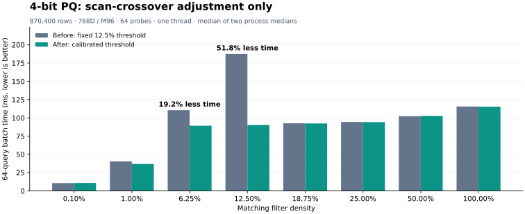

<!--
  ~ Licensed to the Apache Software Foundation (ASF) under one
  ~ or more contributor license agreements.  See the NOTICE file
  ~ distributed with this work for additional information
  ~ regarding copyright ownership.  The ASF licenses this file
  ~ to you under the Apache License, Version 2.0 (the
  ~ "License"); you may not use this file except in compliance
  ~ with the License.  You may obtain a copy of the License at
  ~
  ~   http://www.apache.org/licenses/LICENSE-2.0
  ~
  ~ Unless required by applicable law or agreed to in writing,
  ~ software distributed under the License is distributed on an
  ~ "AS IS" BASIS, WITHOUT WARRANTIES OR CONDITIONS OF ANY
  ~ KIND, either express or implied.  See the License for the
  ~ specific language governing permissions and limitations
  ~ under the License.
-->

# PQ sparse crossover and current-main RQ verification — 2026-11-11

The worktree is now based on `7857f341f57db76ace01606314f25f361ace1f91`, the latest `origin/main` fetched for this run. The three existing PQ optimizations are retained. The earlier [full benchmark](pq-full-20261111.md) used `b083416` and remains a historical result; its RQ throughput decrease does not reproduce against the refreshed main. The accepted additional production change is a calibrated 4-bit transposed scan crossover, with matching diagnostic counters and a shared exact-prefix constant. No additional RQ kernel patch is applied.

Changing only the crossover reduces the production-shaped 4-bit batch time **110.481 → 89.233 ms at 6.25% density** and **187.456 → 90.291 ms at 12.5% density**. The short-list reader case at 25% density improves **184.407 → 140.660 µs** with one thread. Unfiltered production-shaped scan time is effectively unchanged. Result signatures match throughout the threshold comparisons; regression tests also assert individual score bits at either side of the crossover.

[CSV](pq-rq-fixes-20261111.csv) contains medians, ranges and sample counts. [JSON](pq-rq-fixes-20261111.json) retains individual samples, observations, signatures, source hashes and standard-benchmark metadata. Raw stdout/stderr, Criterion samples, source snapshots, patches and experiment scripts are archived under `target/pq-rq-fixes-20261111/pq-rq-fixes-20261111-raw.tar.gz`.

**119 benchmark processes completed successfully:** 12 initial RQ controls, 4 forced-crossover calibration processes, 34 threshold before/after processes, 9 public-data diagnostic pilot processes, and 60 final five-index processes. The exports contain 723 metric comparisons; all 583 signature groups and all 30 recall comparisons agree at the drivers' printed precision.


Raw archive: 1,195,702 bytes, SHA-256 `0460b0d552227a585b5870b584593c8a8c31d1e5a6be15acdc2540d632e06722`. It is a local run artifact under `target/`; the versioned CSV/JSON provide the portable comparison data.

## Revisions and measurement controls

- Fresh main adds `4e282e6` (C++ native open errors) and `7857f34` (#118, RQ multi-bit scans and high-dimensional encoding) to the previous base. Work continues on `codex/pq-rq-performance`; earlier changes were restored from a preserved stash without conflicts. The original PQ source patch was verified unchanged immediately after synchronization.
- **RQ verification:** fresh main versus fresh main plus the original three PQ changes; six processes/version, alternating AB/BA order, before the crossover edit.
- **Crossover isolation:** fresh main plus the original three PQ changes versus that same source plus the new crossover. Both sides use identical benchmark drivers and separate native Cargo build directories. The archive contains exact before/after source snapshots; JSON records their hashes. These results must not be confused with the net PQ gains versus clean main.
- **Final integration:** clean fresh main versus the three PQ changes plus the crossover; the project's `tools/benchmark_pr.py`, all five indexes, six processes/version/index, 60 processes total.
- Apple M4 Pro, 12 logical CPUs, 48 GiB RAM, macOS arm64, rustc 1.95.0; release defaults, identical Cargo.lock, no `target-cpu=native`. Processes run serially without concurrent builds, tests or downloads. CPU frequency and core placement are not pinned. Medians/ranges describe these local runs rather than confidence bounds for other machines.
- Performance measurements are native ARM64. The x86_64-apple-darwin build passes; AVX2 and scalar-only machine throughput have not been measured here.

## RQ diagnosis after synchronizing main

The previous `b083416` report measured RQ sequential −5.9% and batch −8.8%, without establishing a cause. Main now includes #118, so reproducing the comparison on the current implementation is the first diagnostic control.

| Comparison | Sequential QPS, base → candidate | Change | Batch QPS, base → candidate | Change |
| --- | ---: | ---: | ---: | ---: |
| Current main versus retained three PQ changes, before threshold edit | 23,222.98 → 23,619.24 | +1.7% | 82,283.34 → 84,098.65 | +2.2% |
| Current main versus final candidate, all-five-index run | 22,916.48 → 22,890.99 | −0.1% | 83,208.83 → 82,495.36 | −0.9% |

All RQ samples preserve Recall@10 = 90.9033%. Final batch ranges overlap: base 81,785.87–83,703.96 QPS; candidate 82,084.83–83,615.46 QPS. Neither current-main comparison reproduces the earlier decrease, so there is no evidence requiring another RQ patch. This establishes current behavior after synchronization; it does **not** identify an instruction responsible for the historical old-base decrease, or prove #118 alone caused it to disappear.

## Calibrating the crossover

The previous transposed 4-bit rule used sparse scanning for at most 12.5% matching rows regardless of list length or subquantizer count. Dense scanning computes the first 200 rows exactly in f32, then uses a much cheaper quantized SIMD suffix when the u16 bound allows it. The useful matching-row budget therefore depends on list length and M. At M96/6,800 rows, the old rule chose sparse scanning for 850 rows even though dense SIMD was substantially faster. For short lists, the exact prefix makes sparse scanning beneficial beyond the old limit.

The new `pq_sparse_threshold_bench` uses a serialized, memory-backed reader, random PQ codes/codebooks, inner product, nlist=nprobe=1, 16 queries, top-3, seed 42 and one Rayon thread. Each point performs an untimed result capture and three timed runs of at least 40 ms, reporting the median. This isolates scan selection without training or storage I/O differences.

| Matrix | Shapes | Density points | Processes/version |
| --- | --- | --- | ---: |
| Forced sparse/dense calibration | M16/32/64/96/196/256 × rows128/256/1024/4096/6800 | 1/3.12/6.25/12.5/25/50/100% | 2, AB/BA |
| Actual before/after policy | Same 210 points | Same seven points | 3, AB/BA/AB |
| Held-out validation | M24/48/128 × rows512/2048/8192/16384 | 1/5/10/18.75/25/50/100% | 2, AB/BA |
| Exact f32 overflow fallback | M258 × rows128/256/1024/4096/6800 | Original seven points | 2, AB/BA |

Forced variants change only the private transposed 4-bit scan branch in a disposable checkout; they are not retained in production. All 210 forced sparse/dense points have matching result signatures. Held-out shapes and densities were not used to choose the policy.

For native SIMD with M ≤ 257, let L be the list length and E = min(L, 200). The matching-row threshold is:

```text
B = floor(3E / 4) + floor((L − E) / 32)
if M ≤ 32: B = max(B, floor(L / 16))
T = min(B, floor(L / 4))
use sparse scanning when matched_rows ≤ T
```

This retains a measured 6.25% floor for short codes and caps sparse selection at 25%. At L=256, T=64 (25%). At L=6,800/M96, T=356 (about 5.24%), so both 6.25% and 12.5% production cases switch to dense SIMD. Scalar-only and u16-overflow routes use a 25% threshold because their dense path cannot use the cheap SIMD suffix; M258 exercises the exact f32 overflow route on this machine. Row-major 4-bit and all 8-bit selection rules are unchanged.

All 329 before/after matrix points have matching result signatures. In the default matrix, M32/L256/64 matches improves 55.802 → 42.964 µs (−23.0%). One default-matrix median is >10% slower: M16/L4096/127 matches, 48.427 → 54.733 µs (+13.0%); both policies take the same sparse branch there. None of the 84 held-out points is >10% slower. The raw data retains the outlier; these runs do not support a claim that every microbenchmark improves.

The 35-point M258 overflow matrix also has no >10% slower median. At 25% density, L256 improves 473.638 → 178.918 µs (−62.2%) and L6,800 improves 11,052.193 → 3,150.340 µs (−71.5%), both switching from dense exact scanning to sparse exact scanning. This validates the overflow-route threshold on ARM64; it does not supply scalar-only hardware measurements.

## Production-shaped filtering and reader validation

`ivfpq_filter_scan_bench`: 870,400 rows × 768D, M96, 128 lists, 6,800 rows/list, 64 queries, 64 probes, top-3, one thread. Entries are medians of two process medians, each with an untimed signature capture, warmup and three timed batches. Both IDs and f32 distance signatures match at every density in 4-bit and 8-bit modes.



| Matching density | Before, ms | After, ms | Time change | Selection before → after |
| --- | ---: | ---: | ---: | --- |
| 0.10% | 10.764 | 10.939 | +1.6% | sparse → sparse |
| 1.00% | 40.364 | 36.954 | −8.5% | sparse → sparse |
| 6.25% | 110.481 | 89.233 | **−19.2%** | sparse → dense |
| 12.50% | 187.456 | 90.291 | **−51.8%** | sparse → dense |
| 18.75% | 92.589 | 92.321 | −0.3% | dense → dense |
| 25.00% | 94.371 | 94.200 | −0.2% | dense → dense |
| 50.00% | 102.283 | 102.647 | +0.4% | dense → dense |
| 100.00% | 115.532 | 115.261 | −0.2% | dense → dense |

The 1% timing difference occurs on the same scan route and is not attributed to the new rule. The 8-bit controls are in CSV/JSON and retain the same selection rules.

`pq_query_bench` reader-only Criterion cases use 30 samples, 500 ms warmup and 2 s measurement per case, one process/version/thread setting. At L256/25%, the new sparse selection reduces mean time 184.407 → 140.660 µs (−23.7%) with one thread, and 92.310 → 76.703 µs (−16.9%) with four threads. All other cases, including unfiltered readers, are retained in CSV with within-process bootstrap intervals.

## Public trained/serialized quality control

The existing `pq_quality_bench` runs Fashion-MNIST 60k × 784D, 16,384 training rows, 64 queries, top-10, nlist64/nprobe8, L2, no OPQ, four threads, 100%/1%/10% filters. The 4-bit M196 and 8-bit M98 indexes both use 98 bytes/vector. Each throughput mode runs at least 500 ms; each version trains, adds, serializes and opens its own reader. Dataset provenance remains in the earlier full benchmark and its manifest.

The initial two-process 4-bit comparison suggested sequential decreases of 6.8–9.6%, including the unfiltered route where the threshold is unused. A falsifiable follow-up tested whether inlining the helper caused this: a disposable build added `#[inline(never)]`, then three rounds rotated before/after/outlined order. The accepted before/after pair showed sequential changes −0.5% to +0.7%; outlining produced no consistent benefit and was rejected. Production retains the ordinary helper. Both phases and the rejected experimental patch are archived.

| Filter density | Initial 4-bit sequential QPS change, 2 samples/version | Rotated 4-bit sequential QPS change, 3 samples/version | Combined 4-bit sequential / batch QPS change, 5 samples/version | 8-bit sequential / batch QPS change, 2 samples/version |
| --- | ---: | ---: | ---: | ---: |
| 100% | −7.4% | +0.7% | −0.8% / +0.7% | +0.4% / +0.5% |
| 1% | −9.6% | −0.5% | −5.2% / −3.3% | +0.4% / −0.4% |
| 10% | −6.8% | −0.4% | −1.0% / −1.5% | +3.6% / +2.4% |

Combining phases is descriptive and mixes two scheduling protocols; it avoids discarding slower initial trials. There is no established persistent 4-bit sequential regression, but the 1% combined result remains lower and must not be advertised as a gain. Neither outlining nor an unrelated kernel change is justified by this evidence.

All printed sequential/batch recalls are identical between versions: 4-bit 70.9375%/85.7812%/75.6250%, and 8-bit 79.8438%/89.8438%/87.8125%, for 100%/1%/10% respectively. Serialized byte signatures and sizes also match across all processes, including the rejected outlining variant.

## Final integration benchmark and checks

The standard five-index workload on fresh main uses 10k × 64D, 4,096 training rows, 2,048 queries, top-10, nlist64/nprobe8, RQ4, PQ8/M8, two threads, warm page cache and at least one second per timed mode. Six independent processes/version/index run in alternating order. This measures all retained PQ optimizations plus the crossover against clean main; it does not isolate the crossover.

| Index | Sequential QPS, main → candidate | Change | Batch QPS, main → candidate | Change | Recall@10, unchanged |
| --- | ---: | ---: | ---: | ---: | ---: |
| IVF-FLAT | 26,528 → 27,296 | +2.9% | 133,877 → 138,278 | +3.3% | 100.00% |
| IVF-SQ | 105,828 → 105,449 | −0.4% | 199,293 → 199,289 | −0.0% | 99.26% |
| IVF-PQ | 26,010 → 31,627 | **+21.6%** | 149,941 → 232,904 | **+55.3%** | 47.54% |
| IVF-RQ | 22,916 → 22,891 | −0.1% | 83,209 → 82,495 | −0.9% | 90.90% |
| DiskANN | 14,767 → 16,066 | +8.8% | 28,925 → 31,248 | +8.0% | 77.20% |

No DiskANN logic changed, so its timing difference is a control observation rather than an attributed optimization. Benchmark metadata shows identical HEAD SHAs because candidate edits are uncommitted; production fingerprints and archived patches distinguish the actual trees.

All **712 workspace release tests pass**, with two pre-existing ignored tests. The new regression test fails under the old rule, compares every selected ID and f32 score bit against an independent row-major reference, covers both sides of short/long-list boundaries and the u16-overflow fallback, and verifies diagnostic scan-work counters. Clippy with `-D warnings`, formatting, `git diff --check`, ASF header validation, and x86_64-apple-darwin `cargo check` pass. No serialization or score arithmetic change is introduced by this crossover adjustment.

## Reproduction

Use disposable checkouts with the archived before/after source snapshots, copy identical drivers/Cargo bench registrations to both, and build into separate target directories before timing. Run native executable paths emitted by Cargo; do not copy signed executables on macOS. Alternate version order and retain all stdout/stderr.

```bash
RAYON_NUM_THREADS=1 cargo bench --locked -p paimon-vindex-core --bench pq_sparse_threshold_bench
PQ_SPARSE_BENCH_VALIDATION=1 RAYON_NUM_THREADS=1 cargo bench --locked -p paimon-vindex-core --bench pq_sparse_threshold_bench
PQ_SPARSE_BENCH_OVERFLOW=1 RAYON_NUM_THREADS=1 cargo bench --locked -p paimon-vindex-core --bench pq_sparse_threshold_bench
IVFPQ_BENCH_BITS=4 RAYON_NUM_THREADS=1 cargo bench --locked -p paimon-vindex-core --bench ivfpq_filter_scan_bench
IVFPQ_BENCH_BITS=8 RAYON_NUM_THREADS=1 cargo bench --locked -p paimon-vindex-core --bench ivfpq_filter_scan_bench
RAYON_NUM_THREADS=1 cargo bench --locked -p paimon-vindex-core --bench pq_query_bench -- pq4_reader
PQ_QUALITY_DATA_DIR=/path/to/fashion PQ_QUALITY_BITS=4 RAYON_NUM_THREADS=4 cargo bench --locked -p paimon-vindex-core --bench pq_quality_bench
python3 tools/benchmark_pr.py --base /path/to/clean-main --candidate /path/to/candidate --output /path/to/new-output --rounds 6
```

The raw archive includes `calibrate.py`, `compare_threshold.py`, `pilot_outline.py`, `compare_overflow.py` and `summarize.py` for exact scheduling and aggregation. Their paths refer to this run and should be adjusted for a new machine. Rejected experiments and unsuccessful copied-binary startups are not counted as accepted-policy measurements.
